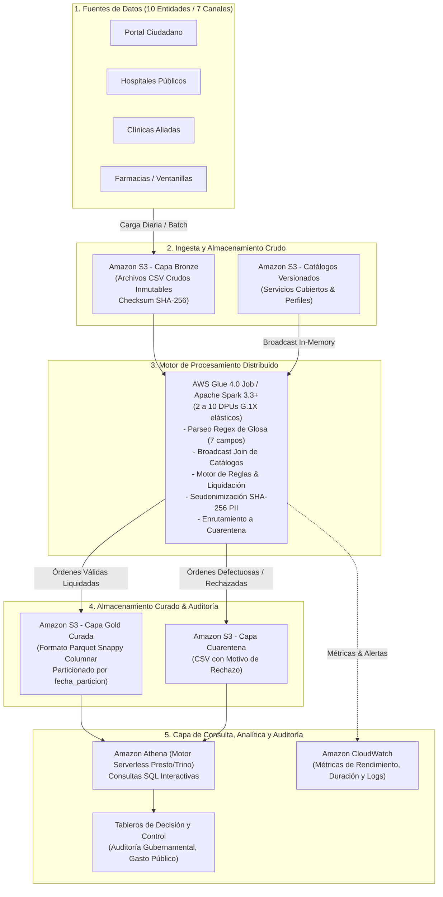
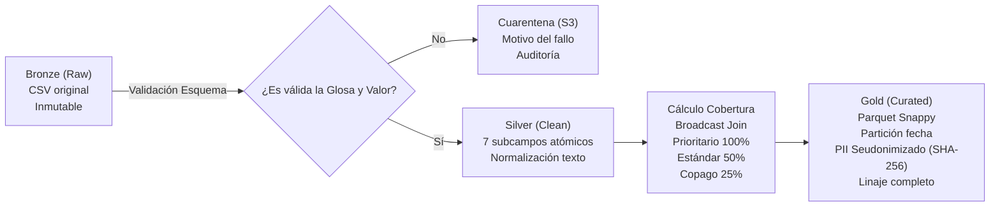
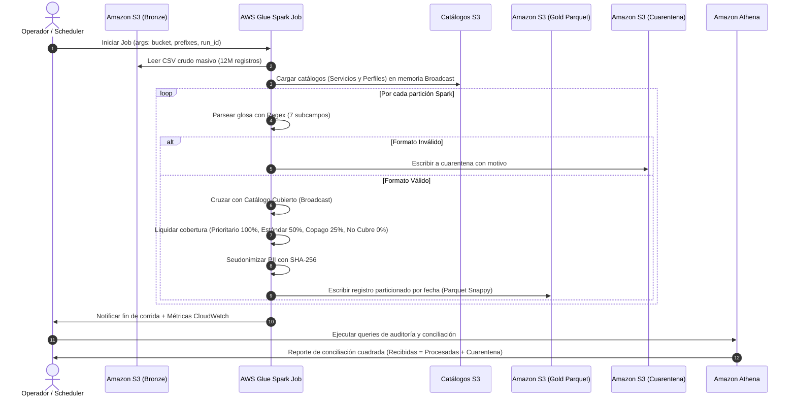

# AI-DLC Inception: Diseño Técnico y Arquitectura Distribuida en AWS
**Proyecto:** Solución Distribuida en la Nube para el Procesamiento Masivo de Órdenes Médicas en un Sistema Público de Salud  
**Marco Metodológico:** AWS Labs AI-DLC (`awslabs/aidlc-workflows`) - Componente de Arquitectura

---

## 1. Visión General de la Arquitectura

Para procesar **12 millones de órdenes médicas** garantizando trazabilidad, exactitud del 100%, cumplimiento de la Ley 1581 (privacidad) y un costo operativo mínimo, se adopta una **Arquitectura de Lago de Datos por Capas (Medallion Lakehouse) sobre AWS**.

### Diagrama de Arquitectura en la Nube de AWS

---

## 2. Flujo de Datos por Capas (Medallion Architecture)

1. **Capa Bronze (`s3://.../bronze/`):**
   * Almacena los archivos CSV tal como son emitidos por los canales y entidades.
   * Totalmente inmutable. Se registra hash SHA-256 de entrada para garantizar que la fuente nunca fue alterada.
2. **Capa de Cuarentena (`s3://.../quarantine/`):**
   * Registros que presenten malformaciones en la glosa (claves faltantes, errores de sintaxis) o valores negativos/no numéricos.
   * Cada registro en cuarentena almacena: `id_solicitud`, `glosa_raw`, `motivo_rechazo`, `id_corrida` y `timestamp_rechazo`.
   * Permite cumplir la ecuación contable:
     $$\text{Total Recibidas} = \text{Total Procesadas en Gold} + \text{Total en Cuarentena}$$
3. **Capa Gold Curada (`s3://.../gold/curated_solicitudes/`):**
   * Almacenamiento en formato **Apache Parquet**, comprimido con **Snappy**.
   * Particionado físico por fecha de solicitud (`fecha_particion=YYYY-MM-DD`), reduciendo drásticamente los datos escaneados en consultas SQL posteriores.
   * **Privacidad garantizada:** Los identificadores directos (`dno`, `seguro_social`, `paciente`) se sustituyen por sus respectivos hashes seudonimizados SHA-256 (`dno_hash`, `seguro_social_hash`, `paciente_hash`).
   * **Trazabilidad:** Cada registro incorpora `id_corrida`, `version_catalogo`, `regla_aplicada` y `timestamp_procesamiento`.

---

## 3. Justificación y Análisis de Trade-Off: Opción 1 (Lotes) vs. Opción 2 (Híbrida/Streaming)

| Criterio | Opción 1: Procesamiento por Lotes (AWS Glue / Spark) | Opción 2: Ingesta Continua e Híbrida (Kinesis/Firehose + Glue) | Decisión del Proyecto |
| :--- | :--- | :--- | :--- |
| **Tiempo de Corrida** | Procesa los 12 millones en **menos de 2 horas** (piloto en ~2 minutos). | Procesa evento a evento durante el día; latencia de segundos/minutos. | **Opción 1** cumple con creces el SLA de $< 24$ horas. |
| **Costo Operativo** | ~**\$0.10 USD por corrida diaria** de 12M órdenes (~\$8.56 USD/mes). | ~**\$11.57 a \$23.92 USD/mes** (costos continuos de shards/ingesta). | **Opción 1** es hasta **60% más económica** y se adapta perfecto al límite de \$50 USD del Learner Lab. |
| **Complejidad de Infraestructura** | Baja: Clúster efímero/serverless que se enciende, procesa y se destruye automáticamente. | Alta: Demanda streaming activo 24/7, control de duplicados en streaming, buffers y dead-letter queues. | **Opción 1** minimiza riesgos de mantenimiento y sobrecostos por recursos desatendidos. |
| **Requerimiento del Negocio** | El gobierno federal liquida al cierre diario de jornada fiscal. | No se requiere aprobación médica en tiempo real para el pago estatal. | **Opción 1** se alinea exactamente con la operación pública fiscal. |

**Veredicto:** Se selecciona la **Opción 1 (Procesamiento por Lotes con AWS Glue Spark)** como la arquitectura principal del proyecto, dejando la arquitectura híbrida documentada como una extensión futura para casos de uso de preautorizaciones en línea.

---

## 4. Diagrama de Secuencia de la Corrida Diaria

