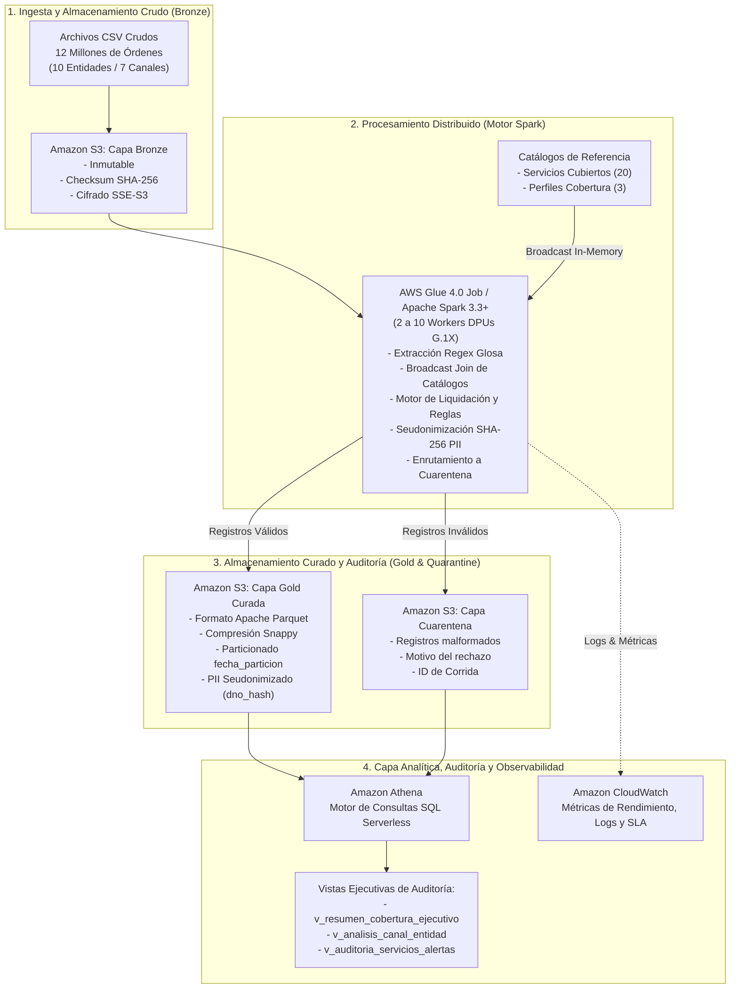

# ENTREGABLE 02: DISEÑO TÉCNICO Y ARQUITECTURA DISTRIBUIDA (25%)
**Proyecto COIL Interdisciplinario:** Big Data y Metodología de la Investigación  
**Tema:** Diseño e implementación de una solución distribuida en la nube para el procesamiento masivo de órdenes médicas  
**Entregable:** Diagrama de Arquitectura, Flujo de Datos, Lógica y Estrategia de Costo

---

## 1. Arquitectura Distribuida en AWS

La solución implementa una **Arquitectura Medallion Lakehouse Serverless** desacoplada, diseñada para maximizar el paralelismo en el cómputo distribuido y minimizar los costos de infraestructura ociosa.

### Diagrama de la Arquitectura en la Nube

---

## 2. Flujo de Datos por Capas y Contratos de Datos

### 2.1 Capa Bronze (Raw Storage)
* **Ubicación:** `s3://<bucket>/bronze/solicitudes/`
* **Formato:** Archivos CSV originales delimitados por comas en codificación UTF-8.
* **Propósito:** Conservación inmutable del histórico de entrada como evidencia legal y de auditoría.

### 2.2 Capa de Cuarentena (Data Quality & Dead Letter)
* **Ubicación:** `s3://<bucket>/quarantine/solicitudes/`
* **Formato:** CSV con esquema extendido:
  `[id_solicitud, fecha_solicitud, glosa_raw, medio_emisor, valor_procedimiento, entidad_emisora, motivo_rechazo, id_corrida, timestamp_rechazo]`
* **Propósito:** Aislar registros que no cumplan el estándar de los 7 subcampos o que contengan valores negativos/no numéricos, garantizando que el clúster nunca aborte por errores de datos y cumpliendo la ecuación contable:
  $$\text{Órdenes Recibidas} = \text{Órdenes Procesadas} + \text{Órdenes en Cuarentena}$$

### 2.3 Capa Gold (Curated Lakehouse)
* **Ubicación:** `s3://<bucket>/gold/curated_solicitudes/fecha_particion=YYYY-MM-DD/`
* **Formato:** Apache Parquet con compresión Snappy.
* **Particionamiento:** Físico por fecha (`fecha_particion`), reduciendo drásticamente el volumen de datos leídos en Athena.
* **Esquema de Datos:**

| Campo | Tipo | Descripción |
| :--- | :--- | :--- |
| `id_solicitud` | `STRING` | Identificador único del trámite médico. |
| `fecha_solicitud` | `STRING` | Fecha y hora exacta de recepción. |
| `fecha_particion` | `DATE` | Clave de partición (`YYYY-MM-DD`). |
| `medio_emisor` | `STRING` | Canal de ingreso (Portal, App, Ventanilla, Hospital). |
| `entidad_emisora` | `STRING` | Prestador o institución de salud. |
| `edad` | `INT` | Edad del paciente extraída de la glosa. |
| `perfil_cobertura` | `STRING` | Perfil del usuario (`PRIORITARIO`, `ESTANDAR`, `COPAGO`). |
| `servicio_solicitado`| `STRING` | Nombre del procedimiento médico solicitado. |
| `codigo_servicio` | `STRING` | Código del catálogo (ej. `COV-001`) o `NON-COVERED`. |
| `categoria_servicio`| `STRING` | Categoría oficial (Consulta, Diagnóstico, Urgencias, etc.). |
| `medicaciones` | `STRING` | Lista de medicamentos asociados al tratamiento. |
| `decision` | `STRING` | `CUBRE` o `NO CUBRE`. |
| `porcentaje_cobertura`| `INT` | 100, 50, 25 o 0. |
| `valor_procedimiento`| `BIGINT` | Valor monetario solicitado en COP. |
| `valor_reconocido` | `BIGINT` | Monto final liquidado a cargo del Estado. |
| `regla_aplicada` | `STRING` | `RN-COV-CATALOGO-V1` o `RN-NOCOV-EXCLUSION-V1`. |
| `version_catalogo` | `STRING` | Versión del catálogo normativo (ej. `2026.1`). |
| `alertas` | `STRING` | Alertas informativas de rango de costo o medicación. |
| `dno_hash` | `STRING` | Hash SHA-256 del documento del paciente (64 caracteres). |
| `seguro_social_hash`| `STRING` | Hash SHA-256 del seguro social del paciente. |
| `paciente_hash` | `STRING` | Hash SHA-256 del nombre del paciente. |
| `id_corrida` | `STRING` | Identificador de ejecución del lote. |
| `timestamp_procesamiento` | `TIMESTAMP` | Marca temporal de la decisión de cobertura. |

---

## 3. Justificación de la Ruta de Solución (Opción 1 vs. Opción 2)

El reto planteaba dos rutas posibles:
1. **Opción 1: Procesamiento por Lotes (Batch con AWS Glue / Spark)**.
2. **Opción 2: Ingesta Continua e Híbrida (Event-Driven con Kinesis/Firehose + Glue)**.

### Evaluación Comparativa

* **Alineación con el Proceso de Negocio:**
  La liquidación de cuentas médicas gubernamentales opera bajo cortes fiscales diarios. Las entidades de salud no requieren una respuesta en microsegundos para efectuar el giro presupuestal.
* **Control Presupuestal y Eficiencia:**
  La Opción 1 enciende recursos únicamente durante los minutos que toma procesar el lote diario (~10 minutos) y los destruye inmediatamente, con un costo de **~\$0.10 USD por corrida**. Por el contrario, la Opción 2 exige mantener brokers o kinesis streams encendidos 24/7, multiplicando el costo mensual y aumentando la complejidad de control de duplicados y transacciones en vuelo.
* **Conclusión:** Se adopta formalmente la **Opción 1**, ofreciendo una solución más robusta, fácil de auditar, inmune a caídas de streaming y económicamente imbatible.

---

## 4. Seguridad, Gobernanza y Privacidad

1. **Cumplimiento de la Ley 1581 de 2012 (Habeas Data):**
   * Los datos personales y sensibles de salud (PII) son seudonimizados mediante el algoritmo estándar de la industria **SHA-256**.
   * Los usuarios analíticos y auditores que consultan la capa Gold a través de Amazon Athena no tienen acceso visual a identificadores en claro, eliminando cualquier riesgo de filtración de datos de pacientes.
2. **Seguridad en la Nube de AWS:**
   * **Cifrado en Reposo:** Habilitado mediante Server-Side Encryption con llaves administradas por Amazon S3 (SSE-S3 AES-256) en todos los buckets.
   * **Control de Acceso:** Políticas IAM de mínimo privilegio vinculadas al rol `LabRole` del AWS Academy Learner Lab.
   * **Aislamiento de Red:** Bloqueo absoluto de acceso público a los buckets (*Block Public Access: ON*).
